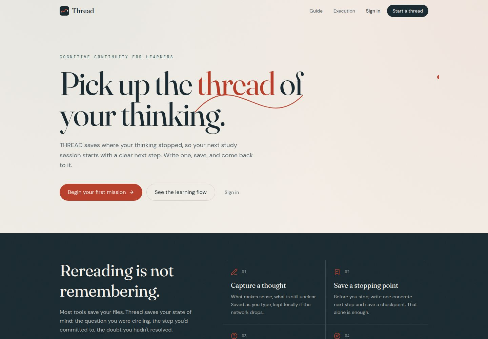
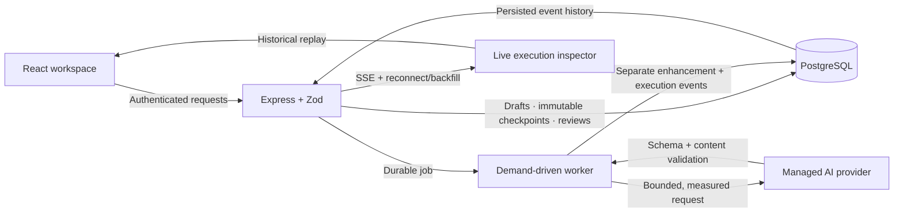
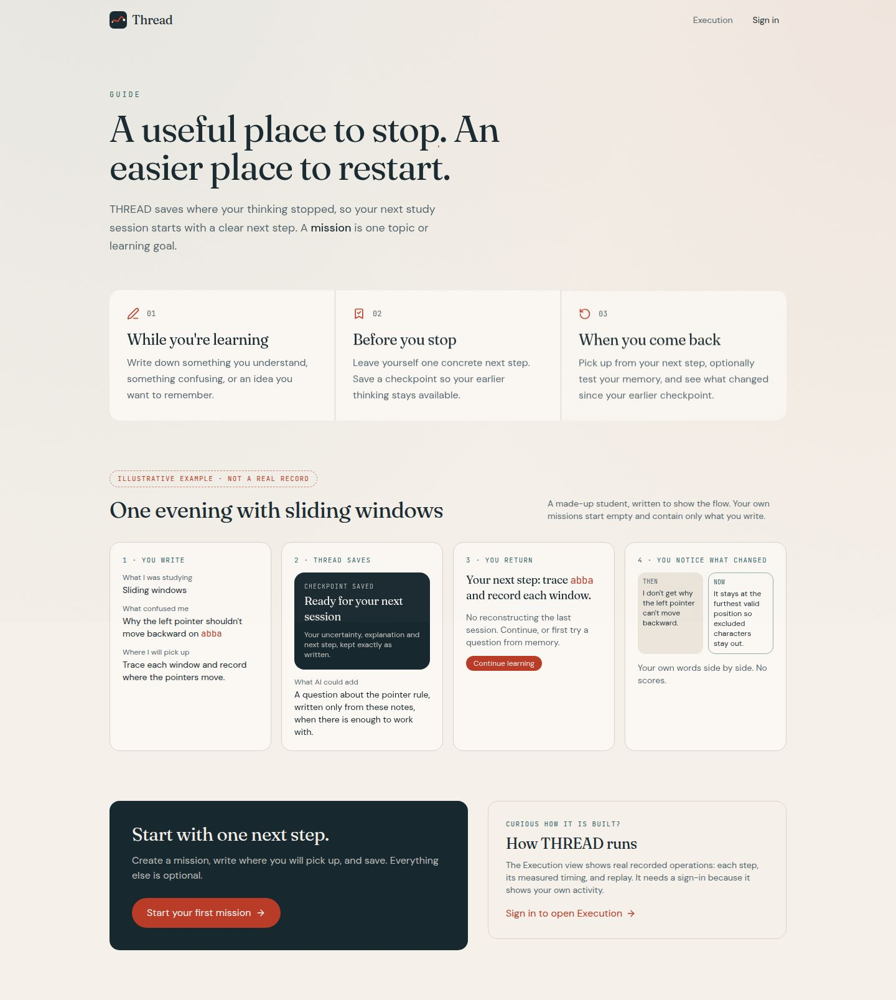

# THREAD · Cognitive Continuity

### Save where your thinking stopped—not just what you studied.

THREAD is a full-stack learning workspace built around one practical problem: returning to a difficult topic is harder when you have forgotten your reasoning, uncertainty, and next step.

Write a thought, preserve an immutable checkpoint, and return to a clear next action. Optional AI and spaced retrieval help you reconstruct your thinking without replacing your original work.

**[Live application](https://thread-cognitive-continuity.replit.app)** · **[Real execution inspector](https://thread-cognitive-continuity.replit.app/how-it-works)** · **[Verification evidence](docs/portfolio/VERIFICATION.md)** · **[Setup](docs/portfolio/SETUP.md)**

> **Source vs. live:** This repository includes the latest learning-experience redesign. The running deployment may be an earlier revision until separately republished. Screenshots below show the verified workspace build. No republishing is performed by the GitHub export.



## What makes THREAD different?

A task manager remembers what you planned to do. A notes app remembers what you wrote. THREAD preserves the connection between **what made sense, what remained uncertain, and where you intended to continue**.

| Experience | What actually happens |
|---|---|
| **Capture without ceremony** | Name a topic and write one next step. Understanding and uncertainty are optional; reasoning and scratch notes expand when needed. |
| **Keep the original** | Autosaved drafts remain editable. Checkpoints preserve the exact saved content; a PostgreSQL trigger prevents checkpoint updates. |
| **Return with context** | Continue from the newest draft, with the last checkpoint's uncertainty separately identified. Older work never silently replaces newer work. |
| **Get grounded AI assistance** | A real server-side provider produces a return cue, personalized retrieval question, and alternative next action. Exact source citations and strict validation constrain the result. AI can still be wrong. |
| **Recall before revealing** | Answer a review question before seeing its reference, self-rate difficulty, and receive a persisted spaced-review schedule. Recall is optional, not a barrier to continuing. |
| **See what changed** | Chronological checkpoints, recall history, and read-only Then/Now comparisons use your actual words—not an invented mastery score. |
| **Inspect the real system** | Live execution events, measured server timings, failures, retries, provenance, and historical replay come from persisted backend records. |

## Try the complete experience

1. **[Open THREAD](https://thread-cognitive-continuity.replit.app)** and sign in. Each learner's missions and execution records are private.
2. Create a topic such as **Sliding windows**.
3. Write a next step: `Trace abba and record both pointers.` Add what makes sense and what remains unclear.
4. Save a checkpoint. See exactly what you can return to; richer content can trigger a real AI enhancement.
5. Leave, reopen the topic, and continue. Change your understanding, then compare the checkpoint with the current draft.
6. Optionally answer a review question, reveal the reference, and rate difficulty.
7. Open **Execution** / **How It Works**, select your recorded run, inspect its steps, and replay it.

**The execution link is not a fake public demonstration.** Sign in and create an operation first to inspect your own real records. Recorded runs from other users are not shared. Replay animates saved events; its playback speed is explicitly separate from measured execution duration.

**AI usage:** Normal AI enhancements use the server's configured managed provider and consume the operator's Replit credits. Very short content, such as an action-only `Start neetcode` checkpoint, uses an explicitly labeled local fallback instead of pretending AI added insight. No production failure-injection toggle is exposed.

## Architecture



*This is an architecture diagram, not simulated runtime telemetry.*

### Engineering decisions worth inspecting

- **Durability before enhancement.** Original learning content is saved independently of AI success. Durable jobs, bounded retries, timeouts, leases, and restart recovery handle interrupted work.
- **Idempotent checkpointing.** A frozen payload and request key survive uncertain responses. Retrying a committed checkpoint does not create another checkpoint.
- **Safe editing and recovery.** Serialized, version-checked draft writes, explicit restore previews, local recovery, and Undo protect newer work. Viewing history is not a write operation.
- **Honest failure states.** Sparse content, unavailable configuration, invalid output, and provider failure are not presented as successful AI generation.
- **Observability as product evidence.** Workflow events record actual steps, outcomes, components, and measured durations in PostgreSQL. SSE provides live updates and historical backfill.
- **Demand-driven idle behavior.** The worker does not sweep an empty queue every second. Checkpoint creation, bounded scheduled wake-ups, and startup recovery drive processing.
- **Explicit production isolation.** Production requires its separate database URL and expected target, verified TLS, a direct session-preserving connection, and startup protections. It cannot silently fall back to the development database.

## Stack

| Layer | Technology |
|---|---|
| Interface | React 19, TypeScript, Vite, Tailwind CSS, Radix UI |
| Client data | TanStack Query, generated OpenAPI client |
| API | Express 5, Zod validation, shared OpenAPI schemas |
| Persistence | PostgreSQL, Drizzle ORM, database constraints/indexes/triggers |
| Identity | Clerk, server-side authorization and ownership checks |
| AI | Server-side OpenAI-compatible managed integration |
| Live updates | Server-Sent Events with reconnection and event backfill |
| Workspace / hosting | pnpm monorepo, Replit application routing; deployment configured separately |

## Verification, not invented metrics

The latest recorded development acceptance run:

| Check | Actual result |
|---|---|
| PostgreSQL-backed backend suite | **91 passed, 0 failed; 1 opt-in live-provider test skipped** |
| Frontend pure regression suite | **34 passed, 0 failed** |
| Workspace typechecks / web production build | **Passed** |
| Connected authenticated desktop journey | **Passed**, with Guide read afterward |
| Genuine managed-provider enhancement | **One successful real job**, one external call, no regeneration for visual polish |
| Lost-response checkpoint recovery | Commit acknowledged on server, response dropped, ordinary retry returned the same checkpoint |
| Restore / Undo | Exact original test-draft fields and whitespace recovered |
| Real execution / replay | Persisted records, corrected finished-replay caption, selected workflow preserved on refresh |

These are dated acceptance results, **not a CI badge or a promise that every environment passes**. Backend failure tests use controlled fixtures; they are not represented as genuine provider outages. See [scope, evidence, and limitations](docs/portfolio/VERIFICATION.md).

## Repository map

```text
artifacts/thread/          React learning experience and execution inspector
artifacts/api-server/      API, durable AI jobs, SSE, and integration tests
artifacts/mockup-sandbox/  Separate design workspace, not the learner app
lib/db/                   Schema, connection guards, and immutability SQL
lib/api-spec/             OpenAPI specification and code generation
lib/api-client-react/     Required generated client source
lib/api-zod/              Shared generated validation source
docs/portfolio/           Public setup, verification, and screenshots
scripts/export-public.mjs Reviewed source-only GitHub export
```

## Run and inspect the source

See **[Setup](docs/portfolio/SETUP.md)** for the supported Replit-first configuration, required environment names, disposable-database tests, and off-platform routing caveats. A fresh clone does not contain production credentials or a ready-made identity/database account.

```bash
pnpm install --frozen-lockfile
pnpm run typecheck
node --experimental-strip-types --test artifacts/thread/src/lib/*.test.mjs
PORT=24644 BASE_PATH=/ pnpm --filter @workspace/thread run build
```

Do not run schema tools or database integration tests against someone else's database. AI generation requires a separately configured provider; production configuration is intentionally fail-closed.

## Scope and limitations

THREAD is a working cognitive-continuity application, not a claim of proven cognitive improvement. It does not invent mastery, retention, accuracy, or learning-speed scores. AI assistance is not an assessment of correctness.

The latest browser evidence is one scripted synthetic-learner desktop journey—not unfamiliar-student research or an exhaustive mobile/accessibility audit. The initial web bundle still has a size warning. Email/OAuth UI and a fresh production deployment were not re-tested as part of the redesign. Source-publication checks do not certify the entire application free of vulnerabilities.

<details>
<summary>Latest workspace Guide screenshot · illustrative example, not a real saved record</summary>



</details>

## License

[MIT](LICENSE), matching the project's existing package metadata. Third-party dependencies retain their own licenses.
